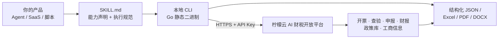

# lemon_skill · 柠檬云 AI 财税开放平台 Skill 集合

> 把 **发票开具、发票查验验真、税务分析、财税政策知识库** 这四类专业能力，**免费**接进你自己的 AI Agent、工作流或 SaaS 产品。
> MIT 开源 · Go 静态二进制零运行时依赖 · 一套技能包同时跑在 7 个主流 AI 客户端
>
> *English companion: see [README_EN.md](README_EN.md) · 本说明以中文为准*


**官方文档与 API Key 申请：** https://www.nmy.cn

---

## 一句话给开发者

中国的发票和税务场景，你自己从头做，成本高到不值得：

| 你想做的事            | 自己做要付出的代价                        | 用这个 Skill 包                                      |
| ---------------- | -------------------------------- | ------------------------------------------------ |
| 开数电发票            | 对接各省市电子税务局、处理扫码登录、开票权限实名认证、会话保活  | `invoice-issue`                                  |
| 给税收分类编码赋码        | 维护上千条商品编码与匹配规则，且每年更新             | 内置智能赋码（`invoice-issue`）                          |
| 发票验真 + 查重        | 对接查验通道、处理限频、解析数电票 PDF/OFD/XML 版式 | `batch-invoice-verify`、`invoice-verify-analysis` |
| 判断一张票能不能抵扣、有没有风险 | 自建风险规则 + 行业税负基线数据                | `invoice-fetch-and-risk-analysis`                |
| 回答"这项支出能不能税前扣除"  | 持续追踪财政部、税务总局、会计准则的**时效性**政策库     | `tax-knowledge`（带官方文件溯源）                         |
| 出一份像样的税务风险报告     | 拉通申报、财报、进销项、工商四路数据再建模            | `tax-analysis`（输出 DOCX / PDF）                    |

**这些我们已经在生产环境跑通了。你只需要一个免费的 API Key，把它接进你的产品。**

---

## 目录

- [能力矩阵](#能力矩阵)
- [30 秒跑起来](#30-秒跑起来)
- [它是怎么工作的](#它是怎么工作的)
- [兼容哪些 AI 客户端](#兼容哪些-ai-客户端)
- [免费额度](#免费额度)
- [仓库结构](#仓库结构)
- [自己构建](#自己构建)
- [凭据与数据安全](#凭据与数据安全)
- [关于贡献](#关于贡献)
- [许可证](#许可证)
- [English Index（英文索引）](#english-index英文索引)

---

## 能力矩阵

每个 Skill 都是一个独立目录，**可单独使用，不需要整套引入**。

| Skill                                                                 | 一句话能力                                        | 典型嵌入场景                | 版本    |
| --------------------------------------------------------------------- | -------------------------------------------- | --------------------- | ----- |
| [`invoice-issue`](invoice-issue/)                                     | 全场景开票：文字/语音单张、Excel 批量、合同/订单等非结构化资料开票，自动智能赋码 | 电商、ERP、CRM 的自动开票模块    | 0.1.6 |
| [`batch-invoice-verify`](batch-invoice-verify/)                       | 批量发票查验 + 重复报销风控 + 自动生成台账                     | 报销系统、差旅平台、财务共享中心      | 0.1.4 |
| [`invoice-verify-analysis`](invoice-verify-analysis/)                 | 发票真伪核验 + 企业征信/供应商尽调分析                        | 供应链风控、供应商准入审核         | 0.1.4 |
| [`invoice-fetch-and-risk-analysis`](invoice-fetch-and-risk-analysis/) | 按企业+期间拉取发票与附件，多维统计、按行业/纳税人属性扫描税务风险           | 代账机构批量体检、企业财税健康度看板    | 0.1.6 |
| [`invoice-reimbursement-assistant`](invoice-reimbursement-assistant/) | 邮箱自动采集发票 → 解析 → 验真 → 去重 → 报销清单归档             | 员工报销、票据中台             | 0.1.4 |
| [`tax-analysis`](tax-analysis/)                                       | 融合申报、财报、进销项、工商数据，AI 输出可跳转目录的税务风险报告           | 财税顾问交付、贷前审查、尽调报告      | 0.1.1 |
| [`tax-knowledge`](tax-knowledge/)                                     | 财税政策检索与解读，每条结论附官方文件来源                        | 财税问答机器人、Agent 的政策依据兜底 | 0.1.4 |

> 资金全流程管理（银行流水/回单/自动对账/资金分析报表）已在官方路线图中，敬请期待。

---

## 30 秒跑起来

### 1. 拿一个免费 API Key

到 [柠檬云 AI 财税开放平台](https://www.nmy.cn) 注册，**控制台 → API Key 管理** 创建即可（记得给 Key 绑定对应能力，如「发票查验」「财税知识库」）。

### 2. 装 Skill，或直接用 CLI

**方式 A：交给 AI 客户端自动装。** 在任意支持 Skill 的客户端里说一句：

```
帮我安装invoice-issue skill
```

客户端会自行下载发布包并按平台拉取二进制，无需你手动处理依赖。

**方式 B：当作命令行工具直接使用（推荐给产品集成）。** 每个 Skill 编译时都会产出对应平台的静态二进制：

```bash
# 财税知识库：政策检索，返回结构化 JSON + 官方文件溯源
tax-knowledge retrieve \
  --query "小规模纳税人 增值税 减免 政策 2026" \
  --api-key "$LEMON_API_KEY" --pretty

# 企业税务风险分析：先看企业列表，再跑分析
tax-analysis enterprises --api-key "$LEMON_API_KEY" --pretty
tax-analysis run \
  --company "示例科技有限公司" \
  --start-month 2025-01 --end-month 2025-12 \
  --api-key "$LEMON_API_KEY" --pretty
```

命令一律输出**可解析 JSON**：成功走 stdout 的业务对象，失败也是 stdout 里的 JSON 错误对象，进度与诊断信息全部写 stderr。**可以直接用管道接进你自己的服务**。

### 3. 把它装进你的 Agent

放进任意一个遵守 `SKILL.md` 约定的 Agent 技能目录即可被自动识别：

```
<your-agent-skills-dir>/
└── tax-knowledge/
    ├── SKILL.md              # frontmatter 声明能力，body 是给模型看的执行规范
    ├── README.md
    ├── tax-knowledge-install.md
    ├── config/
    └── bin/darwin-arm64/tax-knowledge
```

---

## 它是怎么工作的



设计上的几个取舍，都是为了让集成更省事：

- **薄 Agent、厚 CLI。** 凭证管理、重试、异步轮询、限频处理、结果归档这些脏活全部收敛在 CLI 里，模型只负责编排和自然语言理解。不会因为换了个模型版本就跑不通。
- **静态二进制。** Go 单文件编译，不带 Python/Node 运行时，也不需要 `pip install`，沙箱和容器里都很干净。
- **凭据只在运行时。** API Key 只通过 `--api-key` 参数传入，**从不写进源码、配置文件或日志**。配置文件里只放接口端点和能力开关。
- **stdout 干净可解析。** 所有命令约定：业务结果走 stdout 且必须是 JSON，诊断信息走 stderr。

---

## 兼容哪些 AI 客户端

同一套 Skill 包无需改动，可直接用于以下已适配的平台：

[WorkBuddy](https://copilot.tencent.com/work/) · [豆包工作](https://www.doubao.com/work) · [千问办公](https://qwenwork.cn/) · AutoClaw（智谱） · ArkClaw（字节跳动） · MaxClaw（MiniMax） · [OpenClaw](https://openclaw.ai/)

只要你的 Agent 遵循 `SKILL.md` 规范（读取 frontmatter 里的 `name` / `description` 来决定是否调用），这套能力就能挂上去。

---

## 免费额度

开发者和个人用户可以免费接入，以下为开放平台公开额度，**具体以控制台显示为准**：

| 能力          | 免费额度        |
| ----------- | ----------- |
| 发票开具（含智能赋码） | 每月 10,000 张 |
| 发票查验 / 真伪核验 | 每月 20,000 张 |

想做产品级用量、商用授权或更高配额，可在开放平台控制台查看套餐或联系客服。

---

## 仓库结构

```
lemon_skill/
├── invoice-issue/                       # 每个 Skill 一个独立目录
│   ├── SKILL.md                         # 给 Agent 看的能力定义与执行流程
│   ├── README.md                        # 给使用者看的产品说明
│   ├── invoice-issue-install.md         # 安装 / 更新 / 回滚流程
│   └── references/                      # API 契约、字段映射、错误处理、风控边界
├── batch-invoice-verify/
├── invoice-verify-analysis/
├── invoice-fetch-and-risk-analysis/
├── invoice-reimbursement-assistant/
├── tax-analysis/
├── tax-knowledge/
└── go-script/                           # Go 命令行实现 + 生产打包脚本
    ├── lib/                             # 各能力模块源码
    ├── build.js                         # 构建编排
    ├── audit-packages.js                # 发布物审计
    └── config/prod.json                 # 生产接口端点注入
```

`references/` 是最值得先看的部分——那是每个能力的真实接口契约、字段口径和错误码语义。

---

## 自己构建

要求 **Node.js 20+** 与 **Go 1.24+**：

```bash
npm ci
npm run build
npm run audit:prod
```

产物落在 `dist/Skills/<skill>/`：ZIP 包内含 Skill 文档、安装说明、生产运行配置与必要资源；各平台二进制在对应发布目录的 `bin/<platform>/` 下，支持 `windows-amd64`、`linux-amd64`、`linux-arm64`、`darwin-amd64`、`darwin-arm64`。

`dist/` 是本地生成目录，不进 Git。

---

## 凭据与数据安全

- API Key 只由使用者在工作区本地配置，**不得写入源码、文档或日志**；发布包内的配置文件只包含接口端点与能力开关。
- 生产接口端点通过 `go-script/config/prod.json` 在构建期注入。
- 每个 Skill 都内置开户/取数前的预检（`task-preflight-check`），凭证异常会明确阻断而不是带病执行。
- 发票、申报等属于敏感业务数据，请按你所在场景的合规要求进行存储与留痕。
- 发现安全问题，请用本仓库的 **Private vulnerability reporting** 私下提交，**不要开公开 Issue**。详见 [SECURITY.md](SECURITY.md)。

---

## 关于贡献

本仓库用于**公开源码与版本分发**，目前不开放 Issue 与 Pull Request。这不是拒绝反馈——功能建议、适配需求、集成问题，请直接联系开放平台客服，比 Issue 更快得到响应。

---

## 许可证

本项目自有代码、文档与资源采用 [MIT License](LICENSE)，允许商用与二次分发。第三方组件与字体许可见 [THIRD_PARTY_NOTICES.md](THIRD_PARTY_NOTICES.md)。

---

## English Index（英文索引）

面向搜索与外部检索的简要对照，能力定义以本文中文部分为准。完整英文说明见 [README_EN.md](README_EN.md)。

| Skill                             | Official English description                                                                                                          |
| --------------------------------- | ------------------------------------------------------------------------------------------------------------------------------------- |
| `invoice-issue`                   | Supports single, batch, and digital invoice issuance, authorization, and issuance result queries.                                     |
| `batch-invoice-verify`            | Batch-identifies and verifies invoices, checks invoice headers and duplicate risks, and generates a ledger.                           |
| `invoice-verify-analysis`         | Verifies enterprise invoices, analyzes invoice activity and anomaly risks, and generates Excel and PDF reports.                       |
| `invoice-fetch-and-risk-analysis` | Fetches invoices and attachments, analyzes invoice data, and identifies invoice-related risks.                                        |
| `invoice-reimbursement-assistant` | Extracts invoice attachments from email, verifies and categorizes them, checks invoice headers, and generates a reimbursement ledger. |
| `tax-analysis`                    | Synchronizes enterprise tax and business registry data and generates matching navigable DOCX and PDF tax risk reports.                |
| `tax-knowledge`                   | Provides tax policy research, validity checks, applicability guidance, and tax risk explanations.                                     |

**Search terms:** invoice API China · fapiao · fully digitalized invoice (数电发票) · invoice verification · duplicate reimbursement check · invoice OCR · tax classification code · Chinese VAT · corporate tax risk analysis · tax policy database · SKILL.md agent skill · OpenClaw · MCP tool-use

---

<div align="center">

**给 AI 加一块「中国财税」的专业能力，从这里开始。**

[开放平台 · 免费获取 API Key](https://www.nmy.cn) · [能力矩阵](#能力矩阵) · [快速开始](#30-秒跑起来)

</div>

<!-- 关键词：中国发票API 数电发票 全电发票 发票查验 发票验真 发票查重 发票台账 报销归集 发票开具 开票 批量开票 智能赋码 税收分类编码 税务风险分析 纳税申报 财务报表 企业征信 供应商尽调 财税政策库 税收优惠 进项抵扣 税前扣除 增值税 Agent Skill SKILL.md OpenClaw Claude Skill MCP 智能体 财税大模型 代账 invoice API China fapiao API China tax API VAT China digital invoice electronic invoice tax compliance LLM agent tool-use -->
